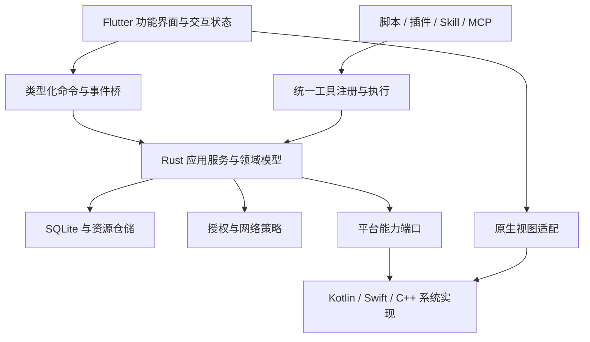

# 整体架构

本文描述目标架构；图中的 tools、permissions、浏览器和媒体完整链路尚未全部接入。实际目录见[仓库布局](repository-layout.md)，已实现接线见[模块目录](module-catalog.md)，当前进度见[状态](../status.md)。

## 分层与所有权

这是逻辑依赖与调用关系，不要求 Rust 直接加载 Dart。平台调用可通过类型化宿主回调、Pigeon/平台通道或原生 FFI 接入；现有 FFI / 平台通道及 Rust/C++ adapter 已按能力接线；新能力复用这些边界。不得在同步 FFI 中阻塞主线程或等待原生 UI 回调。

| 状态 | 唯一权威所有者 | 其它层如何使用 |
| --- | --- | --- |
| 会话、工具运行、下载任务、资源、配置 | Rust 服务和持久层 | Dart 接收带 revision 的只读快照和增量事件 |
| 焦点、选区、动画、展开状态 | 对应 Dart 界面控制器 | 不写入业务数据库，必要偏好通过正式命令保存 |
| WebView、媒体解码器、OS 传输任务、PTY | 对应原生 adapter | Rust 保存稳定 ID 和模型，收到原生回调后协调业务状态 |
| 授权决定与撤销 | permissions 服务 | 系统权限结果作为输入，不可被 UI/扩展伪造 |
| 密钥 | 平台安全存储 | 核心按用途申请，不通过 UI 状态或日志复制 |

## 一条典型执行路径

AI 请求读取附件 → 工具注册表验证 schema → 权限服务检查 workspace、资源、调用者和授权代次 → 文件服务打开 ResourceRef → 平台 adapter 获取受授权句柄 → 读取有界数据 → 持久化执行结果摘要 → 事件流更新界面。手动文件操作使用同一文件服务。

## FFI 与异步契约

以下是未来统一命令的设计要求，不是当前所有 FFI 函数已具备的字段：命令携带请求与工作空间身份，长任务返回可取消任务身份。实际 API 以 `crates/kiyori_ffi/src` 和生成 DTO 为准。事件携带实体 ID、单调 revision、状态与脱敏错误。订阅恢复先获取快照，再应用后续事件；有界缓冲溢出明确要求重取快照，不默默丢失关键完成事件。

领域错误至少区分 `invalid_input`、`permission_denied`、`unsupported_capability`、`unavailable`、`cancelled`、`conflict`、`external_outcome_unknown`。展示文案单独本地化，不把原生异常文本当作稳定 API。

取消令牌贯穿 AI、网络、脚本与原生任务；取消请求与实际终止分开表示。远端请求提交后断线无法确认结果时保留结果未知，不自动重放有副作用调用。只对明确定义的幂等操作使用有限重试与退避。

平台句柄使用带代次 ID 防止复用旧句柄；销毁页面不能默认销毁仍被后台任务持有的资源。退出时先拒绝新任务，取消/结算活跃任务，释放原生资源，再关闭存储与事件通道。

## 性能与复杂度约束

Rust 核心服务按 workspace/session 明确生命周期；不是全局任意访问 service locator。大文件、下载块与媒体帧不经 JSON/Base64 中转；UI 接收元数据、路径授权句柄或纹理。媒体位置等高频事件节流，工具结果与关键状态不能被节流丢弃。

每像素滚动/动画仅刷新对应展示节点；相邻页 UI 预热不启动业务 I/O。AI 流式正文、长列表与
文档按稳定节点/分段增量投影，内容原文保持完整。具体约束和 Profile 测量入口见
[性能契约](../development/performance.md)。模块迁移以[旧模块地图](legacy-module-map.md)核对能力覆盖。

第一版单进程运行；Windows 扩展或终端需要隔离时使用受控子进程。进程隔离、安全沙箱、权限策略是不同机制，任何一个存在都不等于其它机制已完成。
